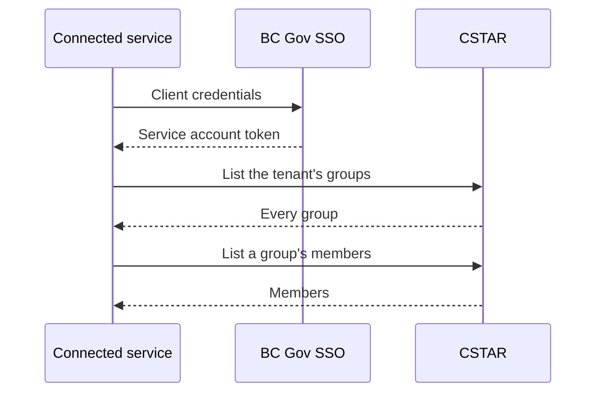

# Service accounts

This page describes how a connected service can read a tenant's groups and their members when no user is signed in. It is intended for connected service teams whose background processes, such as sending notifications, need this information.

## Overview

**A service account allows a connected service to call CSTAR without a signed-in user.**

The connected service obtains a token for its own service account from BC Gov SSO and sends it to CSTAR. Because no user is behind the request, CSTAR cannot check tenant membership or CSTAR roles. Access is limited in other ways instead.

- Service accounts can only read from CSTAR.
- Service accounts can make two requests only. These are listed under [Available requests](#available-requests).
- Service accounts can only read tenants that are associated with the calling service.

**CSTAR does not issue service accounts.**

The connected service team creates and owns its service account in BC Gov SSO. CSTAR records only the service account's client ID.

## Requirements

| Requirement | Detail |
| --- | --- |
| Separate SSO integration | The service account must belong to its own BC Gov SSO integration, separate from the integration used for signed-in users. Its client ID must differ from the service's client identifier. |
| Turned on for the service | An operations admin turns on managing access and service accounts for the service, and records the service account's client ID. Both settings are off by default. |
| Service is active | Service accounts stop working if the service is made inactive. |
| Tenant association | The tenant must be associated with the calling service. |

**Turning either setting off takes effect immediately.**

CSTAR checks the connected service's setup on every request.

## Separate SSO integration

**CSTAR refuses a service account client ID that is the same as the service's client identifier.**

A separate integration has the following benefits.

- The secret of the main integration is used by the service's web application. If that secret is exposed, it cannot be used to read every group and member in the service's tenants.
- The service account can be turned off, or its secret replaced, without affecting signed-in users.
- The client ID shows whether a request was made by a service account or on behalf of a user.

## Getting set up

1. Request a BC Gov SSO integration with a service account in each environment.
2. Send the service account's client ID for each environment to the [CSTAR team](../reference/support.md). Never send the client secret.
3. An operations admin turns on managing access and service accounts for the service, and records the client ID.
4. Tenant owners associate the service with their tenants, if they have not already done so. See [Tenant association](./tenant-association.md).

## Token requirements

**The connected service obtains a token with the client credentials grant.**

```http
POST {issuer}/protocol/openid-connect/token
Content-Type: application/x-www-form-urlencoded

grant_type=client_credentials&client_id={service account client ID}&client_secret={client secret}
```

Service account tokens are short lived. The connected service requests a new token when the current one expires.

**CSTAR checks the following claims.**

| Claim | Requirement |
| --- | --- |
| `azp` | Must match the service account client ID recorded in CSTAR. |
| `aud` | Must be a single value, equal to the service account client ID or to the CSTAR web app's client ID. |
| `idp`, `idir_user_guid`, `bceid_user_guid` | Must not be present. A token that names a user is treated as a user token. |

**CSTAR identifies a service account by its `azp` claim.**

BC Gov SSO sets `azp` to the client that requested the token, and the connected service cannot change it. The `aud` claim can be changed with audience mappers, so CSTAR does not use it to identify a service account.

## Available requests

| Action | Request | Returns |
| --- | --- | --- |
| List a tenant's groups | `GET /v1/tenants/{tenantId}/groups` | Every group in the tenant, including groups that hold no role in the calling service. |
| List a group's members | `GET /v1/tenants/{tenantId}/groups/{groupId}/users` | The name, email address and identity provider of each member of the group. |

**Every other request is refused.**

A request that would make a change is refused as read only. Any other request is refused with a message that lists the requests a service account can make.

**The group members request is available to service accounts only.**

A signed-in user can view a group's members with `GET /v1/tenants/{tenantId}/groups/{groupId}?expand=groupUsers`.



## Group members

**The response lists each active member of the group, sorted by display name.**

```http
GET /v1/tenants/{tenantId}/groups/{groupId}/users
Authorization: Bearer {service account token}
```

```json
{
  "data": {
    "users": [
      {
        "firstName": "Ada",
        "lastName": "Lovelace",
        "displayName": "Lovelace, Ada CITZ:EX",
        "email": "ada.lovelace@gov.bc.ca",
        "idpType": "idir"
      }
    ]
  }
}
```

| Field | Description |
| --- | --- |
| `firstName` | The member's first name. |
| `lastName` | The member's last name. |
| `displayName` | The member's display name. |
| `email` | The member's email address. The value is `null` if no email address is held. |
| `idpType` | `idir` or `bceidbusiness`. |

**Users who have been removed from the tenant are not included.**

## Handling member information

**The connected service is responsible for how it uses the member information it receives.**

Member names and email addresses are personal information. This includes members who are BCeID Business users. The connected service should use member information only for the purpose agreed with the tenant, and should not keep it longer than that purpose requires.

## Errors

| Status | Message | Resolution |
| --- | --- | --- |
| 401 | `Error occurred during authentication` | The token is invalid or expired, or the `aud` claim is not the service account client ID or the CSTAR web app's client ID. |
| 403 | `This connected service is not allowed to call CSTAR with a service account. ...` | Ask an operations admin to turn on managing access and service accounts, or confirm the service is active. |
| 403 | `Service accounts can only read data from CSTAR. ...` | The request would make a change. |
| 403 | `This request cannot be made with a service account. ...` | Use one of the [available requests](#available-requests). |
| 403 | `This tenant does not use {service}. ...` | A tenant owner associates the service with the tenant. |
| 403 | `Only service accounts can use this request. ...` | The group members request was sent with a user token. |
| 404 | `This group does not exist in this tenant. ...` | Check the group ID and the tenant ID. |

## Auditing

**Each request from a service account is logged with the service, the tenant and the number of items returned.**

Requests are not recorded against a user, because no user is involved. Service accounts cannot make changes, so no emails are sent.

## Related pages

- [Authentication](./authentication.md)
- [Connected service setup](./connected-service-setup.md)
- [Tenant association](./tenant-association.md)
- [Troubleshooting access](./troubleshooting-access.md)
