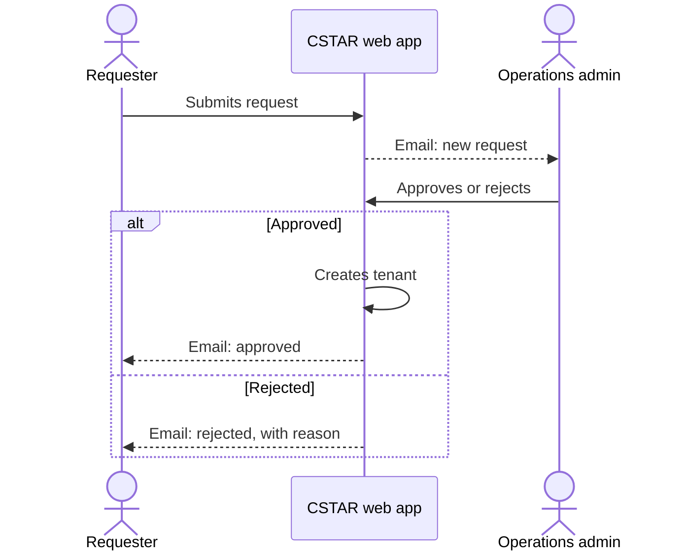

# Tenant requests

This page describes how a new tenant is requested and approved. It is intended for people requesting a tenant and for operations admins who review requests.

## Eligibility

**Only IDIR users can request a tenant.**

A tenant request is submitted in the CSTAR web app, which accepts IDIR sign-in only.

## Process

**A tenant request passes from the requester to an operations admin, and the outcome is emailed to the requester.**

## Submitting a request

| Field | Required | Limit |
| --- | --- | --- |
| Tenant name | Yes | 255 characters. Must not start or end with a space. |
| Ministry name | Yes | 100 characters |
| Description | No | 500 characters |

**The tenant name must not already be in use in the same ministry.**

CSTAR refuses the request if a tenant with the same name and ministry name already exists.

**The CSTAR operations team is notified of each new request.**

See [Email notifications](./email-notifications.md).

## Request statuses

| Status | Meaning |
| --- | --- |
| `NEW` | Submitted and awaiting a decision. |
| `APPROVED` | Approved. The tenant has been created. |
| `REJECTED` | Rejected. No tenant was created. |

**A decision is final.**

A request that is `APPROVED` or `REJECTED` cannot be changed. A requester whose request was rejected can submit a new request.

## Reviewing a request

**Operations admins approve or reject each new request.**

- **Approval.** The operations admin can correct the tenant name before approving. CSTAR checks again that the name is not in use in the same ministry.
- **Rejection.** The operations admin must give a reason. The reason is included in the email sent to the requester.

## Approval

**Approving a request creates the tenant and makes the requester its first tenant owner.**

When a request is approved, CSTAR:

1. creates the tenant with the details from the request
2. adds the requester as a tenant user with the tenant owner, user admin and service user roles
3. emails the requester to confirm the approval

The tenant owner can then associate connected services with the tenant and add users and groups.

## Related pages

- [Tenants](./tenants.md)
- [Email notifications](./email-notifications.md)
- [CSTAR roles](../overview/cstar-roles.md)
